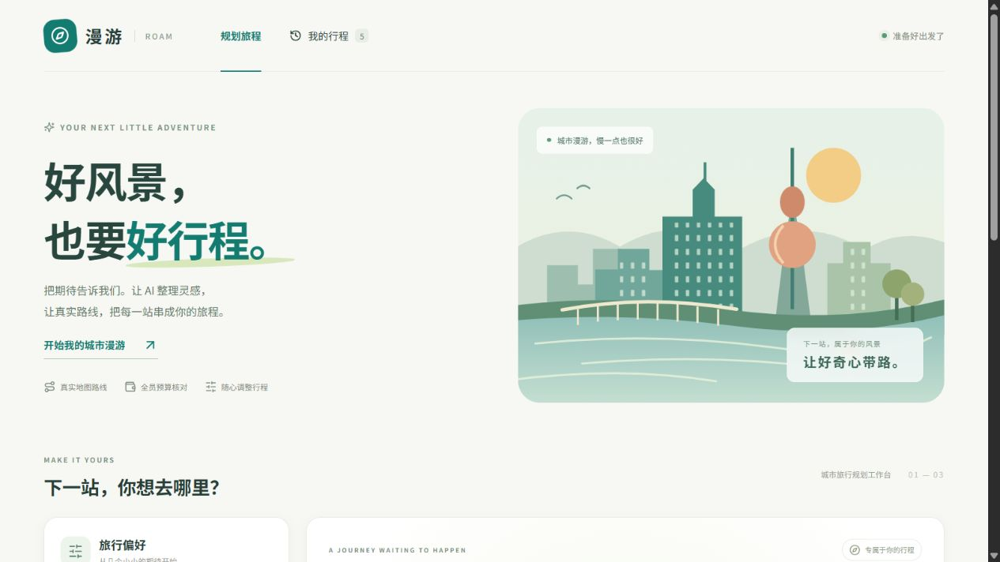

# 漫游 · Travel Assistant

面向 Windows 浏览器的城市旅行规划原型。主体使用 **Python + FastAPI + LangGraph**，界面使用 **Vue 3 + TypeScript + Vite**，以 DeepSeek 和高德的真实工具查询完成行程规划，通过云端模型 API 运行。



## 小队协作入口

新成员先看 [Windows 运行与开发教程](docs/GETTING_STARTED.md)，再看 [当前实现介绍](docs/PROJECT_STATUS.md)。四人可以共用 main，按模块小步提交；具体约定见 [轻量协作](docs/COLLABORATION.md)。给其他 Codex 的工作规则放在根目录 [AGENTS.md](AGENTS.md)，接口与金额等单位见 [API 约定](docs/API_CONTRACT.md)，交接可使用 [工作记录模板](docs/TASKS.md)。全部文档入口在 [docs/README.md](docs/README.md)。

下文“当前机器”指最初开发电脑；新 clone 不含密钥、本地环境与历史数据库，需要按教程初始化。

## 当前机器直接运行

双击项目根目录的 **`start.bat`**，在浏览器访问 [http://127.0.0.1:7862/](http://127.0.0.1:7862/)。启动窗口需要保持运行；关闭时可按 Ctrl+C，或者双击 `stop.bat`。如果本项目已经运行，启动脚本会提示已有服务，不重复启动。

当前机器的 Python 环境、项目独立 Node 22、前端构建和已有 DeepSeek／高德配置已准备好。密钥位于被 Git 忽略的 `.env.local`，不会写入说明、源码或前端构建文件。

## 使用流程

1. 填写目的地城市、出行日期、天数、人数、全员总预算、旅行节奏和步行／驾车方式。
2. 点击生成。Agent 调用城市地点搜索、两点路线查询，再输出结构化每日行程；页面持续显示进度。
3. 浏览每日时间轴与地图。点击地点或地图标记可以联动；地图展示高德返回的真实道路形状。
4. 查看全员费用估算、时间冲突、通行时间不足、重复景点和待确认信息。
5. 输入修改要求，或者让 AI 修正已发现的问题。每次只修改一轮，再查询路线、计算费用与校验；旧版本保留。
6. 在“我的行程”中查看历史版本。

预算是所有同行人员在目的地期间的总费用。出发地作为规划背景。门票、餐饮、住宿费用标为估算；营业时间与预约要求没有经过官方核验，不会被当作已通过检查。

## 在其他 Windows 机器安装

准备 Python 3.11，双击 `setup.bat`，或者运行：

```powershell
.\setup.ps1
```

脚本创建 `.venv`，安装锁定的 Python 依赖，从 Node 官网下载、校验并解压项目独立的 Node 22，然后安装前端锁定依赖并构建。**不修改系统 Node 或全局仓颉环境。**首次联网安装可能需要等待。

将 `.env.example` 复制为 `.env.local`，填写模型与高德设置，之后启动。修改配置后需要重新启动服务。

需要做开发测试时使用 `setup.ps1 -Dev`。前端开发可在当前 PowerShell 临时将 `.tools/node` 加入 PATH，然后在 `frontend` 中执行 `npm run dev`；生产启动使用构建后的同源页面。

## 目录

```text
backend/       Python API、Agent、地图、持久化和校验适配器
frontend/      Vue 界面、地图组件、流式响应客户端
cangjie/       仓颉源码、构建脚本、JSON 协定固定样例
tests/         自动化功能和故障测试
tools/         配置迁移、停止服务、跨语言校验、真实接口验收
docs/          架构、配置、验收与来源说明
.runtime/      本地数据库、进程记录、诊断与验收产物，已忽略
.tools/        项目独立 Node，已忽略
.venv/         项目独立 Python 环境，已忽略
```

## 仓颉模块

仓颉代码统一放在 **`cangjie/src/validator.cj`**。它通过 JSON 标准输入／输出独立校验时间、路线、重复景点与预算，不调用模型或地图。

本机已安装并验证项目独立 Cangjie 1.0.5。`VALIDATOR_BACKEND=auto` 默认在编译程序与固定样例检查通过后启用仓颉；缺失、崩溃、超时或输出格式错误时自动回退 Python。设置 `VALIDATOR_BACKEND=python` 可以始终使用 Python。

在其他机器上仓颉是可选的，Python 和前端可以先正常启动。要启用仓颉：

```powershell
.\.venv\Scripts\python.exe tools\download_cangjie.py
.\cangjie\build.ps1
.\.venv\Scripts\python.exe tools\check_cangjie.py
```

SDK、DLL 和可执行文件都在 `cangjie` 的忽略子目录中。重新构建后无需改变主应用接口。详情见 [仓颉模块说明](cangjie/README.md)。

## 测试与文档

```powershell
.\.venv\Scripts\python.exe -m pytest -q
.\.venv\Scripts\python.exe tools\check_cangjie.py
.\.venv\Scripts\python.exe -m pip check
```

`tools/live_check.py` 会发出真实模型和高德请求，只在需要验收外部接口时手动运行。日常自动化测试不消耗模型额度。

- [配置与额外依赖](docs/CONFIGURATION.md)
- [实现流程与模块分工](docs/ARCHITECTURE.md)
- [当前验收结果](docs/ACCEPTANCE.md)
- [来源与新增工作](docs/ATTRIBUTION.md)

此目录是独立新项目，原 `NVIDIA-TRAVEL` 保持原样。
