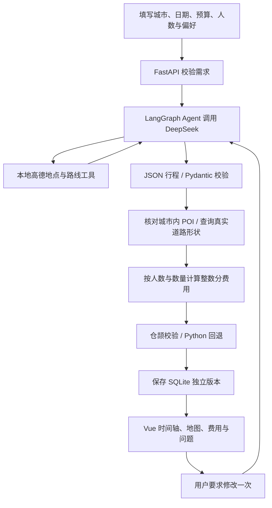

# 功能流程、技术与模块分工

## 从用户需求到可检查行程

用户填写的金额是所选全程所有同行人的总预算，包含目的地间跨城交通；出发交通和返程由明确开关决定。首日开始时间、连续日期、活动和跨城时间均进入校验；旧请求默认保留出发地仅作背景的行为。

城市输入使用 DestinationEditor.vue，以最多五条 destinations 保存城市和 preferred_days（表单默认每城 1 天）。新表单不提交 days，模型在所有城市均指定时长时汇总并向上取整为总天数；显式总天数的旧请求不改写。保留旧 destination 文本读取；六城历史仅可查看。Agent 接收各城时长偏好，Python 将生成活动覆盖的上午／下午转为实际半天数，Python／仓颉统一检查期望是否满足。

城市建议通过 /api/cities 使用高德行政区查询；仅公共城市名缓存 24 小时，用户生成状态和工具缓存仍按请求隔离。

## Agent 在哪里

`backend/agent.py` 中的 `generate_itinerary` 创建 LangGraph `StateGraph`。状态保存当前请求的消息与轮次，每轮让模型选择是否调用 `search_places` 或 `get_route`，执行工具后把结果作为对应的 tool 消息返回模型。模型判断已有足够资料，或者达到 8 轮上限后，结束工具循环并生成结构化行程。

这是实际的模型工具调用循环。页面展示的是工具名、参数摘要和查询结果，不展示隐藏的思考过程。高德工具在 Python 进程内注册、执行。

每个请求独立持有 Agent 状态、高德缓存和事件队列。模型请求上限 60 秒、高德请求 15 秒、整个生成／修改上限 180 秒。最多修复一次 JSON 格式；用户点击修改只执行一次，之后重新校验。浏览器取消／断连会取消当前异步任务并关闭客户端。

## 模块职责

| 模块 | 技术 | 职责 |
|---|---|---|
| `backend/models.py` | Pydantic 2、Decimal | 请求、行程、费用、路线、校验与版本的明确数据结构 |
| `backend/agent.py` | LangGraph、OpenAI 兼容客户端 | 工具调用循环、资料收集、结构化行程、一次格式修复 |
| `backend/amap.py` | HTTPX、MD5 签名 | 城市限制 POI 搜索、匹配、真实步行／驾车线路、请求内缓存 |
| `backend/validation.py` | 纯 Python、异步子进程 | 完整行程规范化、规则检查、仓颉一致性验证和回退 |
| `cangjie/src/validator.cj` | 仓颉 1.0.5 标准库 | 内部 JSON 协定编解码与确定性规则检查 |
| `backend/storage.py` | SQLite | 独立请求 ID、历史版本、父版本关系 |
| `backend/main.py` | FastAPI、SSE | HTTP 接口、进度流、取消、同源前端与地图鉴权代理 |
| `frontend/src/App.vue` | Vue 3、TypeScript | 需求输入、每日时间轴、预算、待确认信息、修改和历史 |
| `frontend/src/components/RouteMap.vue` | 高德 JS API 2.0 | 真实路线形状、地点标记、地图与时间轴联动 |

城市插画是原生 SVG，界面布局使用自定义 CSS，图标使用 Lucide；未直接套管理后台模板。

## 路线与可信数据

模型给出的坐标和定位状态全部丢弃。地点按 stop.city 在请求目的地列表内限制搜索，缓存按城市和关键词区分，不做全国同名地点兜底；POI ID 必须是本次查询过且名称匹配的地点，最终匹配名称显示在界面中。

同城两点路线使用高德 walking／driving 服务，保留 distance、duration、steps.polyline 和查询时间，坐标统一使用高德 GCJ-02。没有真实路线形状时视为不可用，不绘制直线代替。

跨城交通保存在 itinerary.transfers，以独立明细展示（已查时刻、参考票价或估算分别标注），禁止用步行道路代替或用直线冒充导航。journey.py 将所有跨城时间规范化为相对首日午夜的整数分钟，支持跨午夜到达；两套规则引擎检查城市链、缺段、活动冲突和旅行时间范围。

预算由程序统一遍历日费用和跨城费用，按每单位金额、数量与计费范围相乘，最后以整数分汇总。模型不能决定最终总额。餐饮、住宿和门票均为估算，营业时间与预约要求均为待确认项；“已知检查通过”不等于所有旅行事实已经核实。

## 仓颉的实际分工与回退

Python 把 JSON 行程转换为整数金额、整数分钟、活动标识、路线时长和未知信息。仓颉检查超预算、活动结束早于开始、时间重叠、通行时间不足、重复景点、缺失地点／路线。酒店重复入住不算重复景点。

为了避免另引 stdx 运行库，仓颉采用有大小／深度限制的内部 JSON 编解码，支持该协定需要的整数、布尔、字符串、数组、对象与 null，并测试中文、转义字符和 emoji。它不是面向任意外部数据的通用 JSON 库。

启动选择时，编译程序通过固定样例与 Python 一致性检查才能启用。每次执行最多 3 秒。缺失、崩溃、超时、非法 JSON、字段不一致会回退 Python，并在诊断中注明原因。正常发现行程问题仍然返回仓颉校验结果，不会通过换后端掩盖问题。

## HTTP 接口

| 接口 | 返回与用途 |
|---|---|
| `GET /api/health` | 可用能力、缺失设置名称、当前校验后端 |
| `GET /api/map-config` | 公开 Web Key 与代理地址 |
| `POST /api/plans/generate` | SSE：status、tool、result 或 error |
| `GET /api/plans` | 最近 50 个历史版本摘要 |
| `GET /api/plans/{id}` | 某一版本的完整数据 |
| `POST /api/plans/{id}/validate` | 使用已保存路线数据重新执行规则校验，不调用模型 |
| `POST /api/plans/{id}/revise` | 使用旧版与校验结果，一次修改后返回新的 SSE 结果 |
| `GET /_AMapService/{path}` | 受限高德 SDK 代理，不接受任意上游 URL |

生成与修改保存新版本；重新校验返回新的检查结果但不修改历史行程本身。打开历史行程时，界面按当前校验器重新检查；路线仍是该版本生成时的查询结果。

## 可选铁路 MCP

`rail_mcp.py` 负责有超时的 stdio JSON-RPC；`railway.py` 负责请求内缓存、相邻城市／日期限制、实际车站所属城市核验、席位人数与价格关联。第三方服务的固定源码和数据随仓库收录在 third_party/mcp-server-12306；默认 setup 调用独立安装器，将哈希锁定的运行依赖安装于 .tools/rail-mcp/.venv，不加入主应用依赖。启动包装器优先导入仓库内源码，并在缺失时拒绝误用其他来源。`tools/rail_mcp_stdio.py` 启用 TLS 证书校验并补充源车站资源的城市字段；子进程不继承模型／高德密钥。

启用后 Agent 可以调用 `query_train_tickets`。输出 JSON 后再次通过 Railway.enrich 校准；模型或旧版本带来的查询凭据一律清除，只有本次服务结果可以标记 queried。选项 ID 只在当前请求有效。未指定有效选项时尝试在当前时间窗口内选择真实直达车；失败保留估算与原因。接驳时间只使用估算缓冲，不代表真实站外路线。每个请求最多查询六个城市段／日期组合，失败缓存；每次 RPC 限时 25 秒，整体仍限 180 秒，结束或取消时回收子进程。公布票价始终为 reference，预算仍属于估算。
