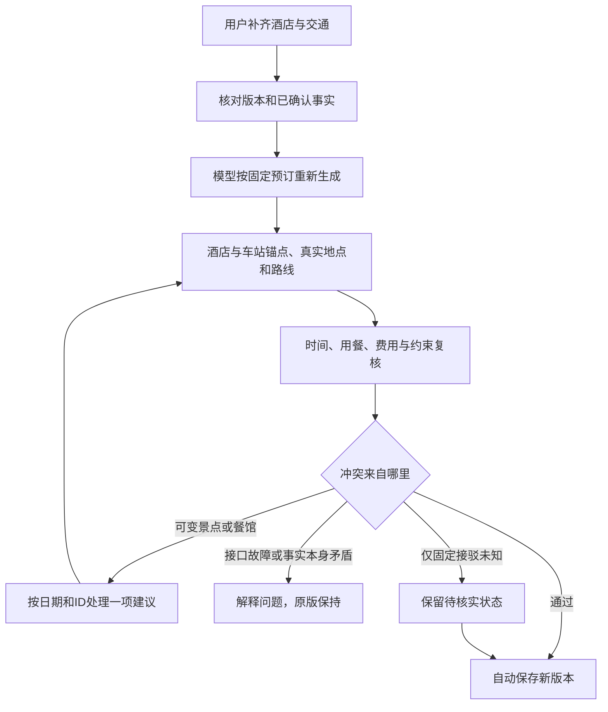

# 知途项目代码修改汇总

更新日期：2026年10月23日。适用目录：`D:\cangjie\zhengkaiyang`。

本文汇总三部分：此前将我方旅游约束版合入队友最新版的工作、用户提供的另一位 AI 交接所述修改，以及本次“补齐住宿与交通后，普通活动路线冲突不应卡死重生成”的专项修复。内容以当前源码、Git版本和实际执行日志为准；不是直接照抄旧交接。

## 一、当前版本与比较基线

| 项目 | 核对结果 |
|---|---|
| 队友最近一次克隆版的比较基线 | `adbe22e`，提交说明“发布知途 v1.0.0” |
| 第一次合入我方约束功能的版本 | `49b35b7`，“合入仓颉约束与途中调整并保留研学功能” |
| 本文核对时的当前提交 | `810faf6b12367822a969177e38166c77d9e6c5df` |
| 当前分支 | `integration/travel-constraints-20261022` |
| 后端源码指纹 | `ae85adae27d46790`，稳定回归前后相同 |
| 本机服务 | `http://127.0.0.1:7868/`；健康检查指纹与磁盘相同，`validator=cangjie` |
| 本文编写前的工作区 | 业务代码已在上述提交内；仅用户原有 `.env.local` 修改未提交。本文是之后新增的说明文档 |

注意：整理期间另一会话更新过提交与服务。因此，早先交接里的“分支为 feature/arrival-hotel-preview”“HEAD=49b35b7”“全部业务改动尚未提交”“运行指纹4c03…”已经是历史状态。本文不按 Git 作者字段强行区分每段 AI 代码归属，而按工作阶段和用户提供的交接划分。

本次比较的底座是队友的知途 v1.0.0，并非最早的 NVIDIA-TRAVEL 原始仓库。

## 二、队友最新版原有、此次保留的内容

以下能力在队友基线中已经存在，不能算成这次从零开发的功能。

| 原有能力 | 本次处理 |
|---|---|
| 普通旅行的模型生成、多目的地与往返安排 | 保留，在其上补充固定预订、约束与恢复逻辑 |
| 历史研学场景 | 保留独立研学生成流程，不套用普通旅行的无引用改写 |
| 研学知识库、RAG检索、原文来源与现场观察任务 | 保留证据结构及原文引用；实际资源包和检索效果另行验收 |
| 研学多轮问答、照片提问 | 保留原会话与照片接口，不改称本次新增多模态模型能力 |
| 多城市天气快照、天气重查和出行建议 | 保留，再调整提醒的展示位置 |
| 联网景点出行参考、来源与查询缓存 | 保留，后续限制列表只显示真正景点 |
| 铁路MCP查询 | 基线已有，后续优化查询时间筛选、已订段保护与时间轴展示 |
| 预算明细、Decimal金额计算 | 保留权威计费方式，补上重生成与删减时的账务保护 |
| 行政区过滤、界面视觉、动效与外观设置 | 保留，与迁入功能做兼容 |

源码证据：初次合并 `adbe22e → 49b35b7` 时，`backend/conversation.py`、`study_agent.py`、`knowledge.py`、`retrieval.py`、`photo_study.py`、`weather.py`、`place_guide.py`，以及前端 `StudyQA.vue`、`WeatherCard.vue`、`BudgetDetails.vue`、`appearance/` 没有该次合并差异。普通旅行 `agent.py` 在初次合并时也未变化，后来的提示词修订属于下一阶段。

## 三、此前由我方版本迁入、集成与修复的内容

### 3.1 仓颉约束规划链

迁入真实仓颉共同校验器和 Engine2.2 有限规划器，支持预算、每日活动时间、真实路线耗时、活动优先级、锁定和途中进度等约束。Python负责组织输入、调用原生程序并独立复核输出，不把Python计算冒充仓颉搜索。

当前工程仍是混合架构：Vue/TypeScript负责界面，Python负责模型、地图、铁路、存储与编排，仓颉负责共同校验和有限规模约束搜索。没有把整个网站或模型接口改写成仓颉。

普通约束搜索窗口为同一城市连续1—3天，每天最多8项、总计最多24项；整趟多城市旅行不等于可以一次交给仓颉做任意规模全局最优搜索。

主要文件：`cangjie/src/validator.cj`、`cangjie/journey_planner/src/main.cj`、`backend/constraint_bridge.py`、`constraint_replan.py`、`constraint_reference.py`。

### 3.2 统一自然语言调整、活动选择与途中调整

- 将普通旅行的文字交流、活动“不去／想去／必去”、锁定和交通方式选择放到同一个调整流程中，不再让两个不同的AI改写入口互相绕过。
- 自然语言先变成具体提案；有歧义时澄清关键项，随后查询地点与路线、计算约束预览，用户确认后应用。
- 途中调整由用户主动打开。已完成、漏游、当前位置和当前时间需要用户确认，系统不按原计划擅自认定“已经去过”。
- 普通旅行使用 `planning_conversation.py`；队友研学问答继续使用 `conversation.py`，避免同名模块覆盖。
- 普通约束和酒店补录接口拒绝直接改写历史研学计划，避免丢掉引用、事实和观察任务。

主要文件：`backend/planning_conversation.py`、`planning_conversation_routes.py`、`constraint_routes.py`，前端 `ConstraintReplan.vue`。

### 3.3 新版本、预览差异与事实保护

加入版本指纹、路线修订号和状态修订号，防止用户拿旧页面覆盖新版本。预览过期返回409，应用时原子保存子版本，保留父版本。旧版编辑、刷新、删除等入口增加事实保护，不能绕过已确认的约束与途中状态。

主要文件：`backend/constraint_storage.py`、`constraint_routes.py`、`main.py`。

### 3.4 多酒店、已订交通与每日接驳

- 从“首城一个酒店名”扩展为多家酒店：城市、具体名称／地址、入住退房日期、全员总额。
- 支持多段已订车票／机票：日期、发到时刻、站点／机场、车次／航班、全员费用。
- 按住宿日期加入酒店出发、寄存／入住、返回等节点，酒店位置参与当天路线。
- 把车站和机场作为真实接驳地点，将已选跨城交通并入每日时间轴。景点到车站／机场的市内路耗与费用另算，站点节点不重复收取跨城票款。
- 补录仅代表用户声明，系统不核验订单，也不自动购买、退订、改签或退款。

主要文件：`backend/models.py`、`bookings.py`、`booking_routes.py`、`transfer_timeline.py`；前端 `BookingEditor.vue`、`HotelFields.vue`、`TransportFields.vue`、`DailyTransfer.vue`。

### 3.5 交通选择、费用与推荐

跨城偏好改为多选，允许不同路段采用不同方式。市内比较步行、公交地铁、打车，并结合距离、通行时间、步行负担、同行人数和全员费用给出推荐原因；保留其他方式供用户选择。

铁路查询使用实际查询快照；机票仍主要是估算和携程等外部查询入口，没有新增可保证实时航班、余票和成交价的机票接口。打车费用也不是实时网约车订单价格。

主要文件：`backend/local_transport_policy.py`、`transport_cost.py`、`railway.py`；前端 `RouteChoices.vue`、`localTransport.ts`。

### 3.6 行程顺序、排时与局部修改

修复活动倒序／重叠被前端再次排序掩盖的问题，按后端节点链路显示，路线匹配相邻两端。排时先计算全部选中日期，全部成功才写入时间，失败不留下“一半顺延”的方案。

局部修改不再重建全部日期的站点，保留未选日期的POI与路线。刷新交通估算时，不清空已付、已承诺和关联预订费用。首次未订出发段的铁路筛选不再被模型草稿中的下午时刻锁死，但不会推荐查询时已经过去的早班。

## 四、用户提供的另一位 AI 交接所述修改

以下按交接的A—G主题重新整理，并根据当前源码纠正已过时细节。

### A. 补录后的整份生成与保存

`BookingEditor.vue` 删除“只重新排时”的主按钮，当前主操作为“按新条件整份重新生成并保存”。调用 `POST /api/plans/{id}/booking-regenerate`，内部候选通过后立即 `storage.apply` 保存新版本并返回 `status=applied`，前端关闭窗口并切换版本，不再加第二次保存确认。

真正冲突时不保存；指纹过期或状态变化仍需重新读取。补录草稿按行程ID与指纹保存到浏览器 `localStorage`，刷新可恢复，成功后清除，不能把另一个版本的过期草稿直接套入。

“调整行程”仍保留预览→确认应用。页面底部的路线／餐馆刷新并入调整面板，已有确认状态时禁用会绕开事实保护的旧刷新入口。

### B. 模型必须服从已订事实，停留不足有单次重试

`agent.booking_facts_instruction` 明确酒店、班次、站点和用户费用是固定输入，禁止改写、重复生成车站活动或声称订单已验证。`journey.merge_booked_transfers` 补齐模型漏掉的已订交通段。

城市停留按半天计算：缺口达到1整天时要求模型重排一次；仍不足则保留 `stay_preference` 告警并解释，不无限重试，也不承诺所有城市天数都能同时满足。

### C. 酒店、用餐与时间自愈

- 酒店作为住宿日期内的起终点，抵达后安排酒店寄存／入住，再衔接餐饮或游览。寄存和入住可用性仍需向酒店确认。
- `arrival_flow.py` 补充用餐规则：早餐07:00—09:30、午餐11:00—14:00、晚餐17:00—20:00；迟到时优先补餐，赶车前装不下则提示备餐／自理，不保证列车或飞机供餐。
- 模型建议的未订交通可顺延并降级为估算、清除旧车次查询声明；用户已经填写的交通不能因此移动。该处理不是所有入口都保证调用的通用优化器。
- 早退房时间受同城出发班次、进站预留和额外20分钟约束，避免把退房放到发车之后。
- “返回酒店”“退房后前往车站”等纯移动描述可合并进真实路线与锚点，避免重复计时。
- 当天放不下时可以移除普通模型建议，而不能裁掉用户酒店、车次或已确认事实。

**预留时间必须区分两套规则：**

| 规则 | 铁路／汽车 | 飞机 |
|---|---|---|
| 发车前到站／安检预留 `departure_buffer` | 默认30分钟 | 默认90分钟 |
| 到达后额外出站／行李预留 `arrival_buffer` | 默认0分钟 | 默认60分钟 |

用户明确填写的值优先，包括0。可见站点节点自身可能另占5分钟，真实市内路耗另算；这些是系统规划假设，不是承运人的官方最低规定。

### D. 地点与行政区解析

修正城市与下辖区县的歧义判断；车站／机场支持常见别名，优先主体地点，区分航站楼、停车场、出入口等附属设施。对南京路步行街这类同名多分类结果优先取可游览主体。

餐饮描述可提取片区，例如“午餐：田子坊一带简餐”；先找明确片区，再找真实餐馆与道路，不把一整段行动描述当餐馆名称，不随机生成坐标。

主要文件：`backend/administrative.py`、`amap.py`、`locality.py`。

### E. 高德公交与打车数据处理

公交使用高德返回顺序中第一个可解析出真实路线形状的方案，不再自行按时长排序；公交方案不携带打车费。枢纽可吸附到1200米内地铁站，额外站内步行单列为估算；超过12公里的步行方案提示不现实。

打车卡展示驾车里程、时间及费用依据。高德出租车估价、公开费率推算和系统预算假设应分清，均不能当作实时网约车成交价。

### F. 提醒与页面顺序

页面按标题、日期、天气、每日行程与地图、出行准备、调整、补录、提醒与检查、预算及操作组织。与某天相关的提醒跟随当天显示，全程提醒另列。

`preparation.build_issues` 将问题逐条关联到日期与活动，带严重程度、分组与跳转信息，同一句去重。`ValidationCard` 保留完整检查清单，`PreparationCard`以准备状态、住宿与交通摘要为主，避免各处重复整份清单；旧 `blocking` 字段继续兼容。

`PlaceGuide.vue` 的出行参考只列真正景点，排除车站／机场；空状态根据当前选择解释。

### G. 金额健壮性

`transport_cost.money` 和出行准备的金额运算改用 `Decimal(str(value))`，兼容整数与Decimal输入，修复整数没有 `quantize` 的异常。预算仍使用后端的权威全员汇总。

## 五、本次针对“楼外楼午餐／杭州东站路线冲突”的专项修复

### 5.1 原来为什么会一直冲突

路线校验把缺失路段的问题挂在后一个地点上。例如“楼外楼午餐 → 杭州东站”失败，错误点名的是杭州东站。旧恢复逻辑按冲突中的名称尝试删活动，但车站受保护，因此没有删掉真正可变的前一个餐馆；固定3轮重试也处理不了更长的连续失败链。

全局按名称删除还可能误伤另一天的同名活动。重生成全部替换活动时，原有实付费用也存在遗漏风险。

### 5.2 现在具体怎么处理

| 情况 | 当前行为 |
|---|---|
| 固定酒店／车站 → 可变餐馆，餐馆无法定位或路线不可用 | 可以移除具体餐馆建议，重新查新相邻路线 |
| 可变餐馆／景点 → 固定车站，缺少可用路线 | 保留车站，处理其前面的可变建议，不再只盯着被点名的车站 |
| 连续多个建议不可达 | 每轮处理一项，再查新邻接、重排、复核；轮数随有限活动数量收敛 |
| 只是用户酒店／车站未定位 | 保留用户原文及其周边可用活动，将相关接驳保留为待核实，不靠删光活动“修好” |
| 两端均受保护，且至少一端是酒店／交通预订锚点，仍缺路线 | 保留未知状态、不可用路线和校验问题；未触及其他保护条件时可以保存待核版本，保存不等于已经可执行 |
| 地图鉴权、网络、限流、配额或服务响应失败 | 停止本次处理并报告服务问题，不把服务失败当作景点不可达，不自动删光行程 |
| 已完成／锁定活动、酒店和交通锚点、关联已付／承诺费用的活动 | 不自动删除；真正的事实冲突仍需用户处理 |

身份定位改为“日期＋活动ID＋当前相邻路段”，不再全局按中文名称猜测删除。非唯一ID也不猜测处理。每次结构变化后查询新邻接，重算受影响日期的交通费，再执行排时、用餐、原生校验和最终事实检查。

上述活动保护针对恢复时的自动裁剪。整份重生成仍可能替换原来的普通活动内容；已付账项需要另行保留，不代表系统保证继续安排每一张旧门票对应的景点。

取消未发生的景点／餐馆会移除关联预算估算；若餐馆取消且没有落实替代，明确提示另选就近餐馆或自理、餐费待补，不伪称找到新餐馆或免费用餐。处理原因保留在新版本的调整记录中。

### 5.3 财务与保存保护

新增独立费用恢复与复核模块：按原日期和经济字段保留已付、已承诺及需要保留的预订账项。活动被替换或模型复用旧ID时，旧费用可与新活动脱钩，但不假定退款，也不抵作新活动门票。

同一酒店新填总额若已经包含旧实付，保留实付、只另列待付差额，避免重复计费；纯预计酒店金额可以更新，实际已付金额不能自动降低。恢复真实费用后超过每日20项时返回明确问题，不等到自动保存时报500。

最终保存前再次检查锁定／完成、每日时段和经济账本，恢复循环不能清掉这些冲突后直接保存。旧版本不会被重写。

主要新增／修改文件：`backend/booking_recovery.py`、`booking_finance.py`、`booking_routes.py`、`bookings.py`、`amap.py`、`locality.py`。

## 六、当前三条用户流程的区别

| 入口 | 用途 | 保存方式 |
|---|---|---|
| 生成第一版 | 未订齐时形成旅游预览，提供住宿片区／交通参考；有已订信息则纳入固定条件 | 正常生成并保留来源、估算与未知状态 |
| 补充酒店与已订交通 | 订好后按实际住宿、站点、时刻重新安排整份普通行程 | 一次确认事实后点击整份生成；成功自动保存子版本，失败保留原版与草稿 |
| 调整行程／途中变化 | 文字与活动选择共同表达要求，或只规划剩余时间 | 先展示解析和仓颉约束预览，用户确认后保存 |

若已经确认完成／锁定活动或每日活动时段，整份重生成入口当前会拒绝绕过这些事实，应使用调整行程。不能把“刷新按钮禁用”理解为任何情况下都允许整份重生成。

## 七、本次实际验证结果

| 检查 | 实际结果／证据范围 |
|---|---|
| 稳定快照完整后端回归 | **772 passed，0 failed，0 skipped，2条已有第三方弃用提示**；56.39秒，源码指纹前后一致 |
| 用户场景与恢复专项 | 覆盖长沙→上海→杭州→长沙补全预订、餐馆→杭州东站、连续多项删减、跨日同名、最终每日时段、费用重算与事实保护；模型和地图为显式离线合成 |
| 真实HTTP保存链路 | TestClient＋真实临时数据库验证：恢复后直接返回applied并保存子版本；费用超限则无预览、无子版本，父版本保留 |
| 地图故障回归 | 使用真实Amap／餐饮解析代码加离线接口桩，验证POI、周边餐馆和道路查询故障不会触发错误删减 |
| 前端 | build通过；全部10个 `check-*.mjs` 通过；12项Node测试通过 |
| 补录前端检查修复 | 原检查脚本调用已删除的calculate方法，会失败；本次改为6组当前组件流程，覆盖自动保存、冲突留窗、取消、迟到响应、草稿与版本过期 |
| 仓颉共同校验器 | 实际执行本机二进制：21固定＋360随机一致性案例通过 |
| 仓颉 Engine2.2 | 实际执行本机二进制：27固定＋19协议拒绝＋80固定种子合成案例通过。本次未改仓颉源码、未重新编译二进制 |
| 浏览器 | 正式页面及历史行程只读查看；桌面与390px检查，未发现横向溢出，临时视口已恢复；未点击真实付费重生成 |
| 数据保护 | 核对基线13份正式行程原始内容哈希均未变化，配置哈希未变；期间正式库增加到16份，不将并发新增记录归为本次隔离测试输出 |

完整日志：`D:\cangjie\zhengkaiyang\.runtime\booking-recovery-stable-pytest.txt`。原生／前端日志以 `.runtime\booking-repair-*` 命名。这些运行证据不包含在正常源码提交范围内。

中途曾有一轮771通过、1失败：原因是测试运行期间工作树仍在修改，导致健康检查的加载指纹与磁盘不同。随后在不修改源码的稳定快照重新执行，才得到上述772项全通过；没有通过放宽该指纹测试消除失败。

## 八、仍未完成或不能宣称已完成的内容

1. 本会话未用真实DeepSeek和高德重放用户这条完整行程；离线成功不能承诺每次模型推荐、营业时间、接口配额和在线路线都有效。
2. 机票实时搜索、订单验证、自动购票／订房／退款没有实现；铁路价格和余票也只是查询时快照。
3. 酒店推荐片区不等于已落实具体酒店。未核实价格、评分、房态或入住／寄存条件不能写成确定事实。
4. 符合上述预订锚点条件的未知接驳可以保存待核版本，但原校验错误和不可用路线仍会显示；两个普通锁定活动之间缺路并不自动获得豁免。不应把“已保存”宣传成“已通过全部可执行性验证”。
5. 恢复是有边界的工程启发式，不保证自动找到最佳替代景点／餐馆；当前允许舍弃不合适建议，并明确留下空余安排和费用未知。
6. 普通旅行的仓颉窗口不能直接修改带原文证据的研学内容；研学资源、照片接口及真实研学效果需分别验收。
7. 城市停留、开放时间、接驳与总预算可能真实互相矛盾，此时仍需用户选择；系统不能修改已订事实来伪造可行方案。
8. 还有少量旧文案需要统一，例如出行准备小入口仍可能写“先预览再确认”，实际补录主操作已经是整份生成后自动保存。此项本次仅记录，未继续改业务界面。
9. 早期 `MERGE_HANDOFF.md` 和 `docs/MERGED_ARCHITECTURE.md` 保留了历史流程、测试数量和环境状态；涉及当前补录保存、时间预留、恢复轮数与提交状态时，以本文及对应最新源码为准。

本文整理与复核没有提交、推送、购买、发送外部消息，也没有修改 `.env.local`、迁移密钥／数据库或覆盖 `xiugaiban`、`yuanshi`。团队贡献、参赛资格、第二台电脑与正式材料仍须由团队实际确认。
